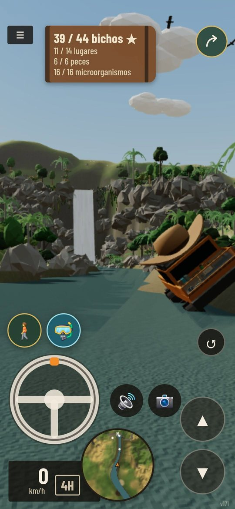
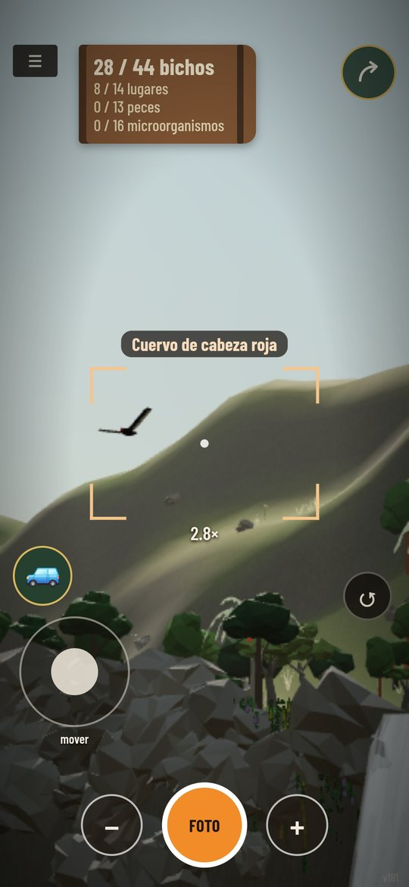
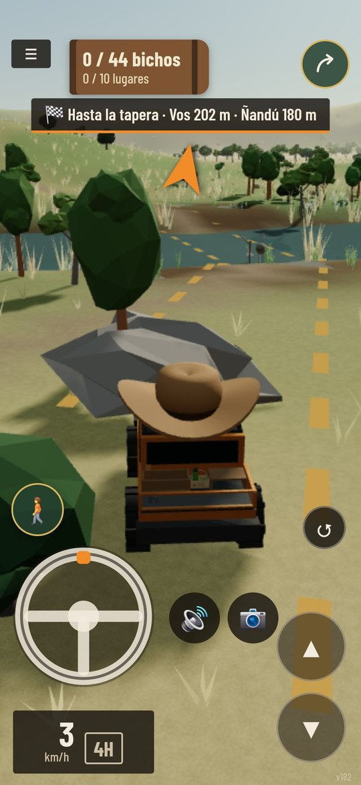
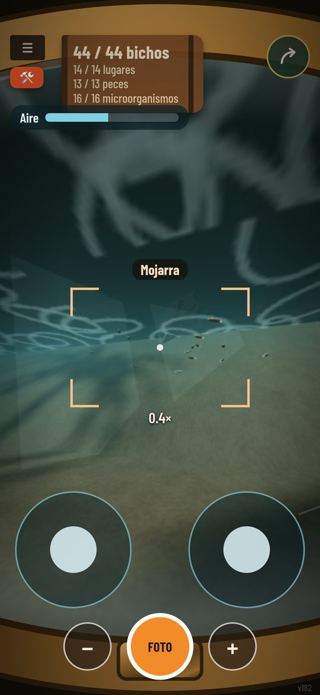
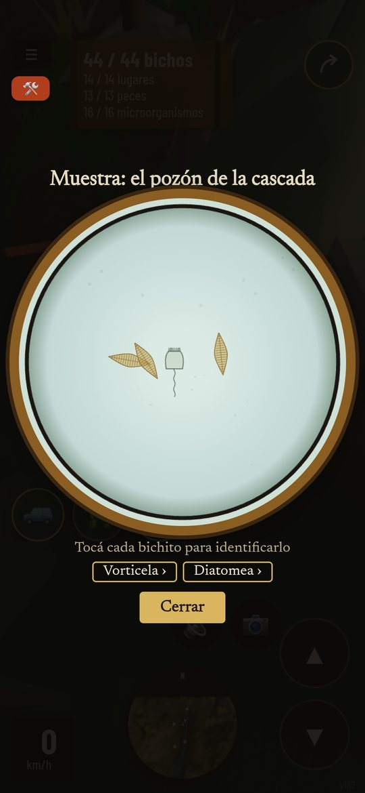
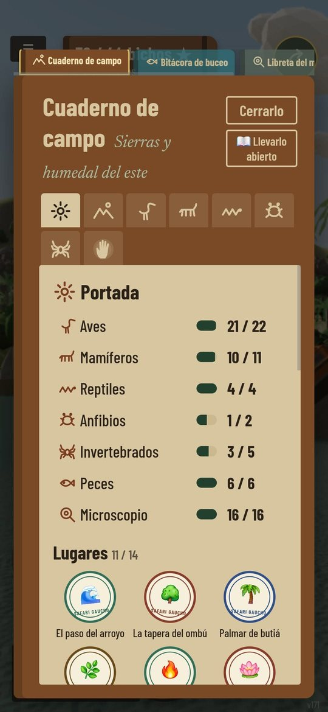

# Safari Gaucho

  
  
  

  
  
  

Un juego de **Insight Reality**, hecho por Pablo Bounous con amor para sus hijos y todos los hijos.

Manejá una 4x4 (eléctrica) por la sierra y el humedal del este de Uruguay y fotografiá los bichos donde viven. Algunos están a la vista; otros, en lugares que hay que encontrar: una quebrada con cascada, una cueva con pinturas, una laguna escondida, un alero detrás del agua. Hay buceo, un microscopio, hallazgos de los primeros habitantes, logros y fotos especiales.

Pensado para chicos de 7 a 12 años: naturaleza uruguaya, un cuaderno de campo con información real y un toque de lo indígena.

**Jugar:** https://pavlko.github.io/4x4natural/

## Para colaborar
- En el juego: ⓘ → **Quiero colaborar** (desbloquea todo para revisar, muestra la galería con modelos y fotos reales, y permite sugerir correcciones desde cada ficha).
- Para opinar sobre las plantas: https://pavlko.github.io/4x4natural/?plantas
- Contacto: insightrealitycontact@gmail.com
- Textos para compartir: [invitar a jugar](JUGAR-MENSAJE.md) · [invitar a colaborar](COLABORAR-MENSAJE.md)

## Novedades
- Para jugadores: [CAMBIOS.md](CAMBIOS.md) · Técnico: [CAMBIOS-TECNICO.md](CAMBIOS-TECNICO.md) · Ideas y planes: [IDEAS.md](IDEAS.md)

## Privacidad
El juego cuenta visitas y avances de forma anónima con GoatCounter (sin cookies ni datos personales). El progreso se guarda solo en el aparato de cada jugador.

## Código abierto y comunidad
El juego es de código abierto (licencia MIT): podés copiarlo, cambiarlo y publicar tu propia versión.

La idea sirve para cualquier lugar del mundo: tus bichos, tus paisajes, tus hallazgos locales, tus logros y tus fotos especiales. Mirá **[CONTRIBUIR.md](CONTRIBUIR.md)** para saber cómo agregar animales, lugares y más, también trabajando con una inteligencia artificial.

## Estructura
- `index.html` — el juego completo en un solo archivo (Three.js; paisaje, animales, plantas y sonidos generados con código, sin fotos ni grabaciones).
- `manifest.webmanifest`, `sw.js`, `icons/` — instalación como app y modo sin conexión.
- `versiones/` — cada versión guardada; `CAMBIOS.md` (novedades para jugadores) y `CAMBIOS-TECNICO.md` (detalle técnico).
- `herramientas/capturas.py` — capturas de la interfaz en varias pantallas (PC, celular vertical y horizontal, tablet) para revisar el diseño.
- `IDEAS.md` — ideas pendientes.

## Cómo se hizo
Idea, diseño y dirección: Pablo Bounous (Insight Reality). Programado conversando con Claude (Anthropic).

## Licencia
Código bajo licencia MIT (ver `LICENSE`). Si publicás tu propia versión, te pedimos que le pongas otro nombre y que menciones de dónde salió.
